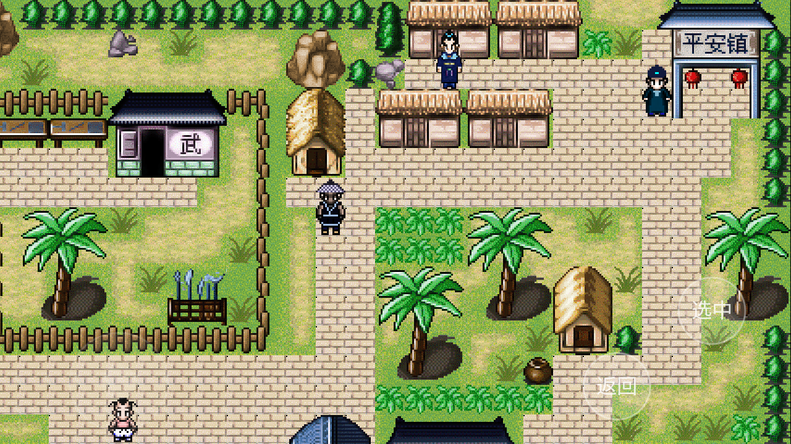
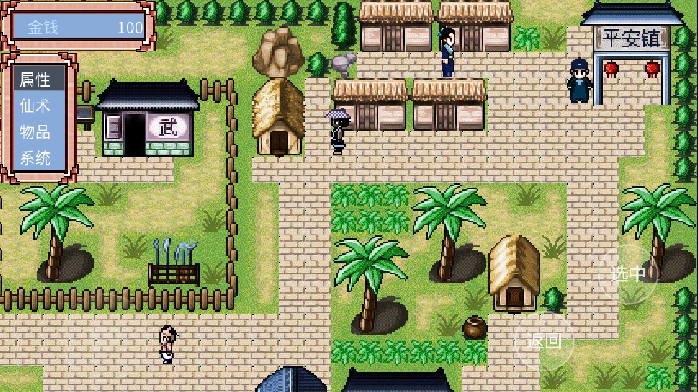
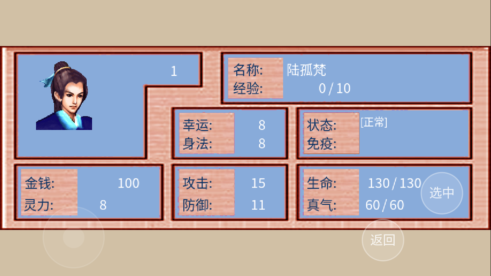

# 天降风云录16-10 Android 移植

> 基于 [mkxp-z](https://github.com/mkxp-z/mkxp-z) 的 RPG Maker XP Android 运行壳。

**仓库：** <https://github.com/happy-bear-x/TianJiangFengYunLu>

---

## 简介

《天降风云录16-10》是 2006 年前后用 RPG Maker XP 制作的武侠 RPG：平安镇出身的陆孤梵，
一路行侠仗义、结识同伴，走完一段带着市井烟火气的江湖故事。

这个仓库把它搬到了 Android 上：原版只能坐在 Windows 前玩，现在手机装个 APK 就能重温，
并且**按现代手游的习惯重做了操作与画面**——不是简单套个模拟器，而是从引擎渲染层和输入层动手。

当前构建：**1.6.0（versionCode 50）**，支持 Android 6.0（API 23）及以上，ARM64 / ARMv7。

### 这一版做了什么

**画面**

- 画布由 4:3（640×480）扩展为 **16:9（853×480）**，1280×720 / 1920×1080 屏幕等比放大
  1.5× / 2.25×，**不留黑边、不横向拉伸变形、不重复图块**；
- 地图横向可视范围从 20 格提升到 **26.7 格**，瓦片渲染同步扩展；
- 镜头在地图边界前停止移动，初始位置也会钳制，不会露出地图外的空白；
- 标题菜单居中，开场 / 结局动画原有的 161px 黑边修正；
- 属性、物品、技能、商店、穿戴等「整屏背景 + 固定槽位」的界面，文字重新对齐回原设计的色块。

**操作**

- 左下角**浮动摇杆**：落指即生成，摇杆帽跟手，支持 8 方向，包含**真正的斜向行走**；
  贴墙斜走时自动沿墙滑行（上有房子拖歪成右上 → 向右走），不会因为一点偏移就原地卡死；
- **界面上可以直接点**：点菜单项即选中并确认，对话框点击推进；
- **点窗口外面 = 返回**，符合现在的手游习惯；
- 地图**左上角隐藏热区**可呼出菜单（等价于屏幕上的「返回」），不占画面；
- 右下角保留「选中 / 返回」两个按钮，物理手柄与键盘通路也一并保留。

---

## 截图

| 标题画面 | 平安镇 |
| --- | --- |
|  |  |

| 主菜单 | 属性（状态） |
| --- | --- |
|  |  |

> 截图为 1280×720 实机画面，左下角淡圈是摇杆的待机提示，左上是隐藏菜单热区（不可见）。

---

## 触屏操作一览

| 操作 | 效果 |
| --- | --- |
| 左下半区按下并拖动 | 唤出浮动摇杆，8 方向移动，斜向为真正的斜走 |
| 点击菜单项 / 列表项 | 选中该项并确认，等价于「选中」按钮 |
| 点击对话框 | 推进对话 |
| 点击窗口外面 | 返回上一层（地图、战斗、标题画面除外） |
| 点击地图左上角 | 呼出主菜单 |
| 右下「选中」/「返回」 | 确认 / 取消，同时兼容物理手柄与键盘 |

已知限制：地图上「点哪走哪」需要寻路，本版未实现；转盘抽奖等自定义排版界面
尚未逐个适配点击命中，仍可用摇杆操作。

---

## 目录结构

```text
TianJiangFengYunLu/
├── app/                    Android 应用模块
│   ├── src/main/java/      Android 壳、mkxp-z 接入与触屏输入层
│   ├── src/main/res/       资源与布局
│   ├── src/main/assets/    core.zip（热更新包）
│   └── build.gradle
├── tianjiang_game/         游戏本体数据（Data/Graphics/Audio/Fonts）
├── app/src/main/jniLibs/   ARM64 / ARMv7 原生库
├── tools/                  构建、安装与数据脚本
├── docs/screenshots/       README 截图
├── gradle/                 Gradle Wrapper
├── gradlew / gradlew.bat
├── settings.gradle
└── README.md
```

游戏数据已在 `tianjiang_game/` 中，可直接修改：

```text
tianjiang_game/
├── Data/       地图、数据库、脚本
├── Graphics/   角色、战斗图、图块、图片
├── Audio/      BGM、BGS、ME、SE
├── Fonts/      游戏字体
├── Game.ini
├── mkxp.json
└── mkxp_compat.rb
```

ARM64 / ARMv7 原生库已放在：

```text
app/src/main/jniLibs/arm64-v8a/
app/src/main/jniLibs/armeabi-v7a/
```

`app/src/main/assets/game.zip` 由 `tianjiang_game/` 通过脚本生成，不提交到 Git。

---

## 构建

### 环境

- JDK 17
- Android SDK（compileSdk 36、build-tools 36.0.0）
- 仓库自带 Gradle Wrapper

### 步骤

1. 生成游戏数据包（仓库已带 `tianjiang_game/`）：

   ```bash
   python3 tools/build_game_zip.py
   ```

   会在 `app/src/main/assets/` 下生成 `game.zip` 和 `core.zip`。

2. 原生库已在 `app/src/main/jniLibs/` 中，无需额外准备。

3. 写入 `local.properties`：

   ```properties
   sdk.dir=/path/to/android-sdk
   ```

4. 构建：

   ```bash
   ./gradlew clean assembleDebug
   ```

5. 产物：

   ```text
   app/build/outputs/apk/debug/app-debug.apk
   ```

> **构建请务必带 `clean`**：`app/src/main/assets/game.zip` 是脚本直接改写的
> （该文件在 `.gitignore` 里），AGP 的增量打包会在旧副本后面再追加一份，
> 结果是 APK 里多出一段不被索引的死数据。实测同一份素材，增量构建出来
> 174 MB，`clean` 之后是 100 MB，功能完全一样——纯属浪费。
> Release 工作流用的就是 `clean assembleDebug`，所以线上包一直是干净的。

> 仅支持 ARM64 / ARMv7（`arm64-v8a`、`armeabi-v7a`）。

### 生成 game.zip / core.zip

`tools/build_game_zip.py` 会同时生成：

- `app/src/main/assets/game.zip`
- `app/src/main/assets/core.zip`

仓库内已包含 `tianjiang_game/`；修改 Data、Graphics、Audio 或 Fonts 后运行：

```bash
python3 tools/build_game_zip.py
```

脚本会重新生成 `game.zip`，并把热更新文件重新打包为 `core.zip`。

---

## core.zip 热更新

- 应用启动时检查 `core.zip`，只刷新小型脚本/数据文件；
- 已解包用户使用 `.ready_v28` 标记，不需要重新解包 60MB；
- 当前 `core.zip` 包含 28 个文件，包括脚本、配置、系统数据和相关地图。

---

## 兼容性

- `applicationId`：`com.tianjiang.fengyun`
- 仅支持 ARM：`arm64-v8a` / `armeabi-v7a`
- 使用原 debug 签名，可覆盖旧测试包；正式分发请自行配置签名
- 更新保留 `Save*.rxdata`，升级前建议手动备份存档
- 需要 Android 6.0（API 23）及以上

---

## 自动发布

推送 `v*` 标签会触发 GitHub Actions：

- 构建 `assembleDebug`；
- 自动创建/更新对应 Release；
- 上传 APK 作为 Release 附件。

工作流文件：`.github/workflows/release.yml`。

## 下载

APK 见仓库的 **Releases** 页面：

<https://github.com/happy-bear-x/TianJiangFengYunLu/releases/latest>

每个版本会提供**两个包**，按自己的偏好选一个装就行：

| 文件 | 说明 |
|---|---|
| `TianJiangFengYun-<版本>.apk` | **原版**（`main` 分支）。游戏内容与原作者版本一致，只做安卓移植必需的适配：触屏操作、宽屏画布、UI 对齐，以及移植过程中暴露的 bug 修复。想原汁原味重温的选这个。 |
| `TianJiangFengYun-<版本>-optimized.apk` | **优化版**（`optimized` 分支）。在原版基础上增加体验增强，目前是**自动存档**：独立于手动存档的 4 个槽位，另有 5 份轮换的自动档，挂机不会覆盖，进新地图或有实际进展时才落盘。 |

两版包名相同，**只能装一个**；覆盖安装会保留存档，换版本不会丢档。

---

## 免责声明

本项目用于 Android 移植、兼容性研究和学习交流，仓库内包含游戏数据以便修改和二次开发。  
《天降风云录16-10》的原始游戏数据、图片、音频、字体及其他素材版权归原作者及相应权利方所有；如果你不是权利人，请仅用于学习研究，不要用于商业分发。若权利人提出异议，请删除对应素材。

---

**仓库：** <https://github.com/happy-bear-x/TianJiangFengYunLu>
