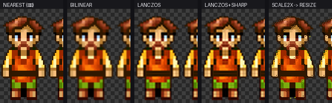

# 高清修复方案调研

> 分支：`hd-remaster`　｜　日期：2026-11-19　｜　状态：调研完成，待选型

## 0. 结论先行

**不建议"全量 AI 超分一把梭"，推荐三段式推进：**

| 阶段 | 做什么 | 预期效果 | 成本 |
| --- | --- | --- | --- |
| **P0** | 改引擎渲染管线：整数倍 2x + 边缘感知放大 shader，再收尾缩放贴合屏幕 | 消灭 2.25x 的 2/3 像素块交替，线条干净、边缘不糊。全屏生效，零素材改动 | 1～2 天，只改 `graphics.cpp` + 新增一个 shader |
| **P1** | 高价值静态资产离线 AI 超分：`Titles` / `Windowskins` / `Icons` / `Battlers` / 部分 `Pictures` | 标题、UI 底图、头像图标真正变高清 | 2～4 天（含人工挑图、修瑕疵） |
| **P2** | 图块与行走图：素材 2x + 引擎"素材倍率"改造（逻辑尺寸虚拟化） | 地图与角色达到真·2 倍像素密度 | 1～2 周，风险最高，收益看 P0/P1 的实际观感再定 |

**核心理由**：这个游戏画面 96% 的面积是 32px 图块和行走图，它们是像素画风格。对像素画来说，AI 超分会"脑补"出不存在的细节、破坏原画风；而规则型边缘感知算法（Scale2x / xBRZ / MMPX）能在**不产生任何新颜色**的前提下把斜线和圆角修圆，这才是这类素材的正解。真正需要 AI 的是标题图、CG、UI 底图这类"手绘/照片"资产。

---

## 1. 现状盘点

### 1.1 渲染管线（决定了接入点在哪）

```
Ruby 场景 → Sprite/Bitmap 绘制 → screen FBO (853×480)
                                      ↓  GraphicsPrivate::redrawScreen()
                                  GLMeta::blitRectangle()
                                      ↓  HAVE_NATIVE_BLIT 为空（GLES2 无 glBlitFramebuffer）
                                  SimpleShader + Quad → 默认帧缓冲 (1920×1080)
```

关键事实：

- **最终放大只经过一个全屏四边形**，`blitRectangle(src, dst, smooth)` 里 `smooth` 来自
  `mkxp.json` 的 `smoothScaling`（当前 `false` → `GL_NEAREST`）。
  → 换放大算法就是替换这一个 quad 的 shader，**不需要碰任何绘制逻辑**。
- `HAVE_NATIVE_BLIT` 实测为空（`gl.BlitFramebuffer` 在 GLES2 上取不到），所以走的是
  shader 路径，**可以插自定义 shader**。
- shader 由 `xxd` 转 C 数组编译进 `.so`（`src/display/gl/shader.cpp` 的 `#include "*.frag.xxd"`），
  **没有运行时加载**。但 WSL 增量编译约 2 秒，迭代不算负担。

### 1.2 素材盘点

| 目录 | 文件数 | 体积 | 说明 |
| --- | --- | --- | --- |
| Pictures | 420 | 41 MB | 大头，CG / 立绘 / 特效，含大量 jpg |
| Animations | 38 | 3.8 MB | 战斗动画帧 |
| Icons | 257 | 1.9 MB | 物品技能图标，24×24 |
| Tilesets | 4 | 1.7 MB | **4 个文件覆盖全部 183 张地图**，256 宽（8 列 × 32px） |
| Battlers | 148 | 1.3 MB | 敌人图 |
| Characters | 99 | 1.2 MB | 行走图，4×4 帧 |
| Autotiles | 83 | 552 K | 自动图块 |
| Titles | 1 | 516 K | 640×480，最该修的一张 |
| 其余 | 36 | ~1.1 MB | 战斗背景 / 远景 / 系统图 / 过渡 |

格式：**897 张 PNG + 189 张 JPG**。JPG 那 189 张自带压缩噪点，AI 超分前必须先去块效应，否则噪点会被一起放大成"细节"。

素材总量只有 **52 MB / 1086 个文件**——这个规模意味着"全量离线超分"在算力上是可行的（本机 CPU 跑 Real-ESRGAN 大约 3～6 小时），**瓶颈不在算力，在画质是否可接受**。

### 1.3 当前画面的问题（实测）

- 1080p 屏上 853 → 1920 是 **2.25 倍非整数**，源图每 2 像素被拉成 4～5 像素，
  竖线粗细 2/3 交替（日志已记录过这个现象）。
- `NEAREST` 让斜线呈锯齿台阶，圆角变方角。
- 换 `BILINEAR` 只是把台阶抹成一团糊——**插值解决不了像素画的清晰度问题**。

---

## 2. 主流方案全景

### A. 运行时全屏放大（shader）

| 方案 | 原理 | 画质 | 移动端成本 | 适配本作 |
| --- | --- | --- | --- | --- |
| **A1** 最近邻 / 双线性 / Lanczos | 插值 | 差～中 | ≈0 | 现状就是 A1 |
| **A2** Scale2x / EPX | 四邻域比较，纯规则复制，**不产生新颜色** | 中上 | ≈0（单 pass） | ★★★★ 像素边缘干净 |
| **A2** xBR / xBRZ | 邻域图案匹配，修斜线与圆角 | 好（但会软化抖动纹理） | 低 | ★★★☆ 适合卡通大色块 |
| **A2** MMPX | 2021 年 JCGT 论文，专为像素画设计，保留调色板与单像素特征 | 最好（业界公认目前像素画最优） | 极低（64K 像素全屏 <0.5ms） | ★★★★★ 官方提供 **OpenGL ES GLSL** 实现 |
| **A2** HQx | 图案识别插值 | 中（渐变色块好，硬边糊） | 低 | ★★☆ |
| **A3** Anime4K v4 | CNN 轻量网络，专治线稿/动漫 | 好 | 中（骁龙 8 系 720p→1080p 约 30fps；中端机吃力） | ★★★ 对 32px 像素画容易"过度锐化" |
| **A3** FSR1 EASU | AMD 空间放大，边缘自适应 | 中上 | 低 | ★★ 为照片/3D 设计 |
| **A4** 实时 ESRGAN | 神经网络推理 | 极好 | 不可行（每帧 1000ms+） | ✗ |

**共同前提**：这类算法都按 **2x 整数倍**设计。2.25x 直接喂进去等于白做，正确管线是：

```
853×480 ──2x 边缘感知──> 1706×960 ──1.125x 双线性──> 1920×1080
```

1.125x 的收尾缩放几乎看不出模糊，而 2x 那一步的收益完整保留。
中间需要一个 1706×960 的 FBO（约 6.5 MB 显存），`GLMeta::blitBegin/blitEnd` 已支持离屏渲染
（`integerScaleBuffer` 就是现成例子）。

### B. 离线 AI 超分（改素材文件）

| 模型 | 适用 | 结论 |
| --- | --- | --- |
| Real-ESRGAN x4plus | 通用照片/纹理 | 对图块会加"照片颗粒"，不适合 |
| **Real-ESRGAN x4plus_anime_6B** | 平涂色块 + 硬线条 | ★ 大色块保持平坦，线稿不糊，**本作最适合** |
| **4x-UltraSharp** | 边缘/文字/UI 截图 | ★ 标题、菜单底图、图标首选 |
| Real-CUGAN | 动漫专用，有降噪档 | 可选，处理 JPG 噪点素材更省事 |
| SwinIR | Transformer，纹理恢复强 | 慢，只对少量 CG 值 |

工具链：`Upscayl`（GUI，NCNN + Vulkan）、`chaiNNer`（节点式）、`realesrgan` CLI（批处理）。
本机 **无 CUDA GPU**（torch 2.15.0+cpu），只能 CPU 推理，约 5～20 秒/张。

**AI 超分的三个硬伤，必须提前接受：**

1. **幻觉**：32px 图块会被"脑补"出砖缝、木纹等不存在的细节，同一图块在不同位置可能长得不一样（模型对上下文的敏感），拼图时接缝会露馅。
2. **风格漂移**：2006 年的手绘像素风 → 变成"现代手游贴图风"，原作味道会丢。
3. **体积**：2x PNG 大约膨胀 3～4 倍，52MB → 150～200MB，APK 从 100MB 涨到 250MB 上下。

所以 B 只适合"独立成块、不参与拼接"的资产：标题、立绘、CG、图标、菜单底图。

### C. 引擎级"素材倍率"改造（真正的 HD 重制）

素材放大 N 倍，但**脚本视角的坐标完全不变**：引擎在 `Bitmap` 上记录真实像素尺寸，
对外 `width()/height()` 仍返回逻辑尺寸，绘制时把源矩形 × N 换成 UV。

改动面（这是 P2 的工程量）：

- `src/display/bitmap.{h,cpp}`：加 `scale` 字段，`width/height` 返回逻辑值
- `BlitShader` / `SpriteShader` / `PlaneShader` 的源矩形换算
- `tileatlas.cpp`：32 全部参数化（`tilesetW = 32*8`、`atAreaW = 32*3*8` 等约 20 处）
- `Bitmap#draw_text`：字号同步 × N，否则文字会显得比贴图粗糙
- 图集单元从 32 涨到 64，显存 × 4（图集本来就小，可接受）

好处：脚本零改动、地图逻辑零改动、接缝天然对齐（图块本身整体放大，边缘连续）。
坏处：改动面广、需要逐场景回归（菜单、商店、战斗、过场全都要看一遍）。

### D. 混合分层（推荐）

P0 的实时放大做底（覆盖所有没超分的部分），P1 的超分资产做面（关键画面）。
两者不冲突：超分过的素材在图块级放大后会被再次过一遍 shader，2x 之后再 2x 会偏软，
所以 P2 落地时应给已超分素材加"跳过实时放大"的标记——**这是 P0 设计时就要预留的开关**。

---

## 3. 实测对比（本作真实素材）

脚本：`tools/hd/compare_scalers.py`，输出在 `docs/hd-research/`。
用 Scale2x（EPX）代表规则型算法的下限——它比 MMPX/xBRZ 弱，但已经能说明问题。


标题图：NEAREST 块状明显；BILINEAR / LANCZOS 边缘平顺但发虚；LANCZOS+SHARP 出现白边振铃
（锐化过头的典型症状）；Scale2x 保留云层纹理又修顺了边缘。



行走图最能说明问题：NEAREST 是硬台阶，BILINEAR 整个人糊掉，LANCZOS+SHARP 在轮廓外
镶了一圈白边，**只有 Scale2x 既保住像素硬边、又把斜线修顺了**。


结论：**对像素类素材，规则型算法的观感明显优于任何插值；而这类算法几乎不要钱。**

---

## 4. 本项目的特殊约束

1. **shader 编译期嵌入**——换算法要重编 `.so`，但 WSL 增量编译 2 秒，可忽略。
2. **`tileatlas.cpp` 里 32 硬编码**——P2 的主要工作量。
3. **Ruby 脚本里 32 / 640 / 480 遍布**——这是 P2 必须走"引擎虚拟化"而不是"改脚本"的原因。
4. **只编了 arm64-v8a**，armeabi-v7a 还是原版 `.so`，任何引擎改动都要同步编 v7a 才能全量发布。
5. **动态画布**：`MainActivity.writeScreenMetrics()` 会按设备写 `defScreenW/H`，853×480 不是常量，
   放大管线必须按运行时的 `scRes` 计算，不能写死。
6. **189 张 JPG**：超分前要先做去块/去噪，否则噪点被当成细节强化。
7. **合规**：这是 2006 年商业游戏的素材，超分产物属修改资产，只宜自用/非商业分发，
   README 需注明，不做公开下载包。

---

## 5. 推荐路线

### P0：运行时放大管线（先做，1～2 天）

1. 新增 `shader/xbr.frag`（或直接上 MMPX 的官方 GLES 实现），xxd 嵌入。
2. `GraphicsPrivate` 加一个 `upscaleBuffer` FBO（`scRes × 2`，随 `resizeScreen` 重建）。
3. `redrawScreen()` 改成两段：
   - `screen → upscaleBuffer`（放大 shader，2x）
   - `upscaleBuffer → 默认帧缓冲`（双线性，`scSize` 收尾）
4. `mkxp.json` 加开关 `"hdUpscale": false|"xbr"|"mmpx"`，默认关，方便 A/B。
5. 验收：MuMu 上 1280×720 / 1080p 各截一张，斜线无台阶、无 2/3 像素块；FPS 不低于现在。

> 这一步做完就能给熊哥看效果，也决定 P1/P2 值不值得继续。

### P1：高价值资产 AI 超分（P0 满意后）

1. 先修 `Title.png`（640×480 → 1920×1440 再缩到 16:9 需要的位置），单张就能改变第一印象。
2. 再修 `Windowskins/`（2 个）、`Icons/`（257 个 24×24 → 48×48）、`Battlers/`（148 个）。
3. `Pictures/` 里按实际引用筛（420 个未必都用），只修 CG / 立绘。
4. 流程：去噪 → Real-ESRGAN anime6B（或 4x-UltraSharp）→ 降回目标倍率 → 人工抽检 → 替换。
5. 验收：逐张 A/B 对比，**出现幻觉细节或风格漂移的一律退回原图**。

### P2：图块与行走图（视 P0/P1 效果再定）

先做 2 倍率（不是 3、4 倍——素材本来就是 32px，4x 出来是 128px 的"假高清"，反而更假），
按第 2 节 C 的清单逐项改造，每改一项就在游戏里跑一遍菜单 / 商店 / 战斗 / 过场。

---

## 6. 需要拍板的三个问题

1. **P0 用哪个算法**：MMPX（像素画最优、风格保真）还是 xBRZ（线条更顺、略软）还是 Anime4K（最锐、但可能过度处理）？
   建议先三个都编进去，实机截图对比再定。
2. **能接受多大的包体**：素材全 2x 会让 APK 涨到约 250MB。
   可选的折中：只超分关键资产（包体 +30MB 以内），其余靠 P0 实时放大兜。
3. **P2 做不做**：如果 P0 出来观感已经够好，P2 的两周工程量可能不值。

---

## 附：参考

- MMPX: <https://jcgt.org/published/0010/02/04/>（含 OpenGL ES GLSL 参考实现）
- Anime4K: <https://github.com/bloc97/Anime4K>
- Real-ESRGAN: <https://github.com/xinntao/Real-ESRGAN>
- 模型库（含 4x-UltraSharp / anime6B 说明）: <https://upscale.wiki/wiki/Model_Database>
