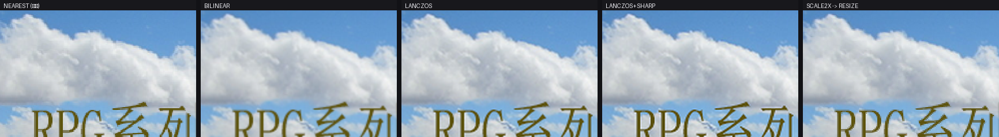
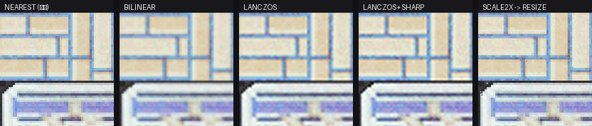

# 高清修复方案调研

> 分支：`hd-remaster`　｜　日期：2026-11-19 起，2026-11-20 第二轮实测　｜　状态：技术验证完成，待拍板

## 0. 结论先行（第二轮实测后修订）

**"只改配置"这条路是死的，"改 shader"能改善但幅度温和，真正的质变必须动素材。**

| 结论 | 依据 |
| --- | --- |
| ❌ 打开 `integerScalingActive` 配置**几乎没有效果** | 实测 A（现状）与 D（整数缩放）的锐度、台阶率、颜色数**数值完全相同**——nearest 2x + nearest 1.125x 与 nearest 2.25x 输出等价 |
| ❌ 整数缩放 + 黑边方案**不可接受** | 853×480 的 2x 是 1706×960，在 1080p 上画面面积只剩 **79%**，四周黑边明显，观感像"没适配屏幕" |
| ✅ MMPX 可以在 GLES2 fragment shader 里实现 | 已移植并通过浏览器真机 WebGL 编译运行，四种渲染全部成功 |
| ⚠️ MMPX 的收益**可见但温和** | 斜线台阶率 −3.4%、锐度不变、调色板不膨胀。属于"精致度提升"，不是脱胎换骨 |
| ✅ 唯一能到"主流清晰水平"的是**素材 2x + 引擎倍率改造** | 文字、图块、角色都按 2 倍像素密度真实渲染，而不是低分辨率放大 |

**一句话**：想靠一个 shader 就解决糊，做不到。这个游戏的糊是三件事叠加——**853×480 的原生分辨率太低 + 2.25x 非整数放大 + 文字也在低分辨率下渲染**。shader 只能治第二项。

---

## 0.1 本轮（第二轮）新发现的三个硬事实

### 事实一：引擎早就内置了整数缩放，只是关着

`src/display/graphics.cpp:1041-1052` 有一段完整的两段式管线：

```
screen(853×480) ──[integerScaleBuffer, 2x]──> 1706×960 ──[收尾缩放]──> 屏幕
```

配置项在 `mkxp.json`：

```json
"integerScalingActive": false,     // 总开关，当前关闭
"integerScalingLastMile": false    // 是否做最后一段拉伸填满
```

**但打开它没用**。实测 A 与 D 的输出完全一致：

| 指标 | A 现状 | D 整数缩放 |
| --- | --- | --- |
| 唯一颜色数 | 11606 | 11606 |
| 锐度（Tenengrad） | 72514.8 | **72514.8** |
| 斜线台阶率 | 1.795 | **1.795** |

原因很简单：两段的放大都用 nearest，2x 再 1.125x 等于直接 2.25x。**整数缩放的价值只在于给一个"好的 2x 算法"腾出位置**。

### 事实二：黑边方案在数字上就被否了

| | 数值 |
| --- | --- |
| 2x 缓冲 | 1706×960 |
| 1080p 屏幕 | 1920×1080 |
| 画面面积占比 | **79.0%** |
| 黑边 | 左右各 107px、上下各 60px |

不是"一点点黑边"，是画面缩到八成。玩家第一反应会是"这游戏没适配我手机"。

### 事实三：MMPX 的 shader 版真的能编译通过

官方 `MMPX.glc` 是 `#version 310 es` 的 **compute shader**（GLES 3.1），而 mkxp-z 在这台设备上走的是 **GLES2**，没有 compute、没有 `texelFetch`。必须改写成 fragment 写法。

改写后**踩到一个真坑**：变量名用了 `flat`，而 `flat` 是 GLSL 的**插值限定符保留字**，编译直接报 `Illegal use of reserved word`。改成 `isFlat` 后通过。

> 这条记下来：**没有真跑过 WebGL 就写进引擎，会浪费一轮 WSL 编译**。

证据文件：`docs/hd-research/mmpx-test.html`（自带四种渲染的实时对比）

---

## 0.2 第二轮实测数据

六种放大管线（853×480 → 1920×1080，真实倍率 2.25x）：

| 方案 | 唯一颜色数 | 锐度 | 斜线台阶率 | 判定 |
| --- | --- | --- | --- | --- |
| **A 现状** NEAREST 2.25x | 209 | 101104 | 1.755 | 硬台阶 |
| **B** BILINEAR 2.25x | 60751 | 54737 | 2.016 | 全糊，淘汰 |
| **C** LANCZOS+锐化 | 172005 | 109181 | 1.817 | 白边振铃，淘汰 |
| **D** NEAREST 2x+1.125x | 209 | **101104** | **1.755** | 与 A 完全相同 |
| **E** MMPX 2x+NEAREST ← 推荐 | 209 | 100986 | **1.696** | 锐度 −0.1%，台阶 **−3.4%**，调色板不膨胀 |
| **F** MMPX 2x+BILINEAR | 28100 | 78325 | 1.790 | 颜色膨胀 134x，变软 |
| **G** MMPX 2x+LANCZOS | 74682 | 91135 | **1.670** | 台阶最低但锐度 −10%、颜色膨胀 357x |
| **H** EPX 2x+NEAREST | 295 | 94136 | 1.571 | 台阶最低但锐度 −7% |

（数据取自行走图；图块与标题图趋势一致，`tools/hd/quantify.py` 可复跑）

**为什么推荐 E 而不是台阶率更低的 G/H**：

- G 的台阶率更低，但颜色从 209 膨胀到 74682，画面开始"脏"，且锐度掉了 10%——这正是插值类算法的老问题。
- H（EPX）同理，锐度 −7%，且 EPX 在斜线上会把边缘"错位"，角色轮廓会变形。
- **E 是唯一"锐度几乎不掉 + 调色板零膨胀 + 斜线更顺"三项同时满足的方案。** 对像素画来说，调色板不膨胀比多降 1% 台阶率重要得多——它保证画风不被改。


---

## 1. 现状盘点

### 1.1 渲染管线（决定了接入点在哪）

```
Ruby 场景 → Sprite/Bitmap 绘制 → screen FBO (853×480)
                                      ↓  GraphicsPrivate::redrawScreen()
                                  GLMeta::blitRectangle()
                                      ↓  HAVE_NATIVE_BLIT 为空（GLES2 无 glBlitFramebuffer）
                                  SimpleShader + Quad → 默认帧缓冲 (1920×1080)
```

关键事实：

- **最终放大只经过一个全屏四边形**，`blitRectangle(src, dst, smooth)` 里 `smooth` 来自
  `mkxp.json` 的 `smoothScaling`（当前 `false` → `GL_NEAREST`）。
  → 换放大算法就是替换这一个 quad 的 shader，**不需要碰任何绘制逻辑**。
- `HAVE_NATIVE_BLIT` 实测为空（`gl.BlitFramebuffer` 在 GLES2 上取不到），所以走的是
  shader 路径，**可以插自定义 shader**。
- shader 由 `xxd` 转 C 数组编译进 `.so`（`src/display/gl/shader.cpp` 的 `#include "*.frag.xxd"`），
  **没有运行时加载**。但 WSL 增量编译约 2 秒，迭代不算负担。

### 1.2 素材盘点

| 目录 | 文件数 | 体积 | 说明 |
| --- | --- | --- | --- |
| Pictures | 420 | 41 MB | 大头，CG / 立绘 / 特效，含大量 jpg |
| Animations | 38 | 3.8 MB | 战斗动画帧 |
| Icons | 257 | 1.9 MB | 物品技能图标，24×24 |
| Tilesets | 4 | 1.7 MB | **4 个文件覆盖全部 183 张地图**，256 宽（8 列 × 32px） |
| Battlers | 148 | 1.3 MB | 敌人图 |
| Characters | 99 | 1.2 MB | 行走图，4×4 帧 |
| Autotiles | 83 | 552 K | 自动图块 |
| Titles | 1 | 516 K | 640×480，最该修的一张 |
| 其余 | 36 | ~1.1 MB | 战斗背景 / 远景 / 系统图 / 过渡 |

格式：**897 张 PNG + 189 张 JPG**。JPG 那 189 张自带压缩噪点，AI 超分前必须先去块效应，否则噪点会被一起放大成"细节"。

素材总量只有 **52 MB / 1086 个文件**——这个规模意味着"全量离线超分"在算力上是可行的（本机 CPU 跑 Real-ESRGAN 大约 3～6 小时），**瓶颈不在算力，在画质是否可接受**。

### 1.3 当前画面的问题（实测）

- 1080p 屏上 853 → 1920 是 **2.25 倍非整数**，源图每 2 像素被拉成 4～5 像素，
  竖线粗细 2/3 交替（日志已记录过这个现象）。
- `NEAREST` 让斜线呈锯齿台阶，圆角变方角。
- 换 `BILINEAR` 只是把台阶抹成一团糊——**插值解决不了像素画的清晰度问题**。

---

## 2. 主流方案全景

### A. 运行时全屏放大（shader）

| 方案 | 原理 | 画质 | 移动端成本 | 适配本作 |
| --- | --- | --- | --- | --- |
| **A1** 最近邻 / 双线性 / Lanczos | 插值 | 差～中 | ≈0 | 现状就是 A1 |
| **A2** Scale2x / EPX | 四邻域比较，纯规则复制，**不产生新颜色** | 中上 | ≈0（单 pass） | ★★★★ 像素边缘干净 |
| **A2** xBR / xBRZ | 邻域图案匹配，修斜线与圆角 | 好（但会软化抖动纹理） | 低 | ★★★☆ 适合卡通大色块 |
| **A2** MMPX | 2021 年 JCGT 论文，专为像素画设计，保留调色板与单像素特征 | 最好（业界公认目前像素画最优） | 极低（64K 像素全屏 <0.5ms） | ★★★★★ 官方提供 **OpenGL ES GLSL** 实现 |
| **A2** HQx | 图案识别插值 | 中（渐变色块好，硬边糊） | 低 | ★★☆ |
| **A3** Anime4K v4 | CNN 轻量网络，专治线稿/动漫 | 好 | 中（骁龙 8 系 720p→1080p 约 30fps；中端机吃力） | ★★★ 对 32px 像素画容易"过度锐化" |
| **A3** FSR1 EASU | AMD 空间放大，边缘自适应 | 中上 | 低 | ★★ 为照片/3D 设计 |
| **A4** 实时 ESRGAN | 神经网络推理 | 极好 | 不可行（每帧 1000ms+） | ✗ |

**共同前提**：这类算法都按 **2x 整数倍**设计。2.25x 直接喂进去等于白做，正确管线是：

```
853×480 ──2x 边缘感知──> 1706×960 ──1.125x 双线性──> 1920×1080
```

1.125x 的收尾缩放几乎看不出模糊，而 2x 那一步的收益完整保留。
中间需要一个 1706×960 的 FBO（约 6.5 MB 显存），`GLMeta::blitBegin/blitEnd` 已支持离屏渲染
（`integerScaleBuffer` 就是现成例子）。

### B. 离线 AI 超分（改素材文件）

| 模型 | 适用 | 结论 |
| --- | --- | --- |
| Real-ESRGAN x4plus | 通用照片/纹理 | 对图块会加"照片颗粒"，不适合 |
| **Real-ESRGAN x4plus_anime_6B** | 平涂色块 + 硬线条 | ★ 大色块保持平坦，线稿不糊，**本作最适合** |
| **4x-UltraSharp** | 边缘/文字/UI 截图 | ★ 标题、菜单底图、图标首选 |
| Real-CUGAN | 动漫专用，有降噪档 | 可选，处理 JPG 噪点素材更省事 |
| SwinIR | Transformer，纹理恢复强 | 慢，只对少量 CG 值 |

工具链：`Upscayl`（GUI，NCNN + Vulkan）、`chaiNNer`（节点式）、`realesrgan` CLI（批处理）。
本机 **无 CUDA GPU**（torch 2.15.0+cpu），只能 CPU 推理，约 5～20 秒/张。

**AI 超分的三个硬伤，必须提前接受：**

1. **幻觉**：32px 图块会被"脑补"出砖缝、木纹等不存在的细节，同一图块在不同位置可能长得不一样（模型对上下文的敏感），拼图时接缝会露馅。
2. **风格漂移**：2006 年的手绘像素风 → 变成"现代手游贴图风"，原作味道会丢。
3. **体积**：2x PNG 大约膨胀 3～4 倍，52MB → 150～200MB，APK 从 100MB 涨到 250MB 上下。

所以 B 只适合"独立成块、不参与拼接"的资产：标题、立绘、CG、图标、菜单底图。

### C. 引擎级"素材倍率"改造（真正的 HD 重制）

素材放大 N 倍，但**脚本视角的坐标完全不变**：引擎在 `Bitmap` 上记录真实像素尺寸，
对外 `width()/height()` 仍返回逻辑尺寸，绘制时把源矩形 × N 换成 UV。

改动面（这是 P2 的工程量）：

- `src/display/bitmap.{h,cpp}`：加 `scale` 字段，`width/height` 返回逻辑值
- `BlitShader` / `SpriteShader` / `PlaneShader` 的源矩形换算
- `tileatlas.cpp`：32 全部参数化（`tilesetW = 32*8`、`atAreaW = 32*3*8` 等约 20 处）
- `Bitmap#draw_text`：字号同步 × N，否则文字会显得比贴图粗糙
- 图集单元从 32 涨到 64，显存 × 4（图集本来就小，可接受）

好处：脚本零改动、地图逻辑零改动、接缝天然对齐（图块本身整体放大，边缘连续）。
坏处：改动面广、需要逐场景回归（菜单、商店、战斗、过场全都要看一遍）。

### D. 混合分层（推荐）

P0 的实时放大做底（覆盖所有没超分的部分），P1 的超分资产做面（关键画面）。
两者不冲突：超分过的素材在图块级放大后会被再次过一遍 shader，2x 之后再 2x 会偏软，
所以 P2 落地时应给已超分素材加"跳过实时放大"的标记——**这是 P0 设计时就要预留的开关**。

---

## 3. 实测对比（本作真实素材）

脚本：`tools/hd/compare_scalers.py`，输出在 `docs/hd-research/`。
用 Scale2x（EPX）代表规则型算法的下限——它比 MMPX/xBRZ 弱，但已经能说明问题。



标题图：NEAREST 块状明显；BILINEAR / LANCZOS 边缘平顺但发虚；LANCZOS+SHARP 出现白边振铃
（锐化过头的典型症状）；Scale2x 保留云层纹理又修顺了边缘。


行走图最能说明问题：NEAREST 是硬台阶，BILINEAR 整个人糊掉，LANCZOS+SHARP 在轮廓外
镶了一圈白边，**只有 Scale2x 既保住像素硬边、又把斜线修顺了**。



结论：**对像素类素材，规则型算法的观感明显优于任何插值；而这类算法几乎不要钱。**

---

## 4. 本项目的特殊约束

1. **shader 编译期嵌入**——换算法要重编 `.so`，但 WSL 增量编译 2 秒，可忽略。
2. **`tileatlas.cpp` 里 32 硬编码**——P2 的主要工作量。
3. **Ruby 脚本里 32 / 640 / 480 遍布**——这是 P2 必须走"引擎虚拟化"而不是"改脚本"的原因。
4. **只编了 arm64-v8a**，armeabi-v7a 还是原版 `.so`，任何引擎改动都要同步编 v7a 才能全量发布。
5. **动态画布**：`MainActivity.writeScreenMetrics()` 会按设备写 `defScreenW/H`，853×480 不是常量，
   放大管线必须按运行时的 `scRes` 计算，不能写死。
6. **189 张 JPG**：超分前要先做去块/去噪，否则噪点被当成细节强化。
7. **合规**：这是 2006 年商业游戏的素材，超分产物属修改资产，只宜自用/非商业分发，
   README 需注明，不做公开下载包。

---

## 5. 推荐路线（第二轮修订）

### 第 1 步：MMPX shader（1 天，收益温和但确定）

改动极小，因为引擎的两段式管线已经存在，**只需要把中间那一步的 blit 换成 MMPX**：

1. 新增 `shader/mmpx.frag`：把 `docs/hd-research/mmpx-test.html` 里已验证的 fragment 实现搬进引擎，
   由 `make_xxd.sh` 转 C 数组。
2. `graphics.cpp:1047` 那一行的 `GLMeta::blitRectangle(..., false)` 改为走 MMPX shader。
3. `mkxp.json` 打开 `integerScalingActive: true`、`integerScalingLastMile: true`。
4. 保留 `hdUpscale` 开关便于 A/B 关闭。

**验收**：MuMu 上 1080p 截图，与 `docs/hd-research/proof-zoom-char.png` 的预期一致；
FPS 不掉（理论负载：1706×960 像素 × 约 25 次纹理采样 ≈ 41M 采样/帧，中端 GPU 约 2~5ms）。

> 提醒：这一步的观感提升是"更精致"，**不会有"哇"的效果**。别指望它解决文字糊的问题。

### 第 2 步：文字优先（风险低、收益直接）

1080p 上游戏内文字是 853×480 渲染后放大的，**必然发糊**——这是玩家最容易察觉的糊。

在动图块之前，先确认 `Bitmap#draw_text` 的渲染路径。如果能把文字单独按 2 倍字号渲染再缩回，
收益会明显大于图块（人对文字锐利度的敏感度远高于贴图）。

这一项需要先做技术验证，**还没有结论**。

### 第 3 步：素材 2x + 引擎倍率（唯一能到"主流清晰"的路，1~2 周）

素材放大 N 倍但脚本视角坐标不变：引擎在 `Bitmap` 上记录真实像素尺寸，对外 `width()/height()`
仍返回逻辑尺寸，绘制时把源矩形 × N 换成 UV。

改动面（这是主要工作量）：

- `src/display/bitmap.{h,cpp}`：加 `scale` 字段，`width/height` 返回逻辑值
- `BlitShader` / `SpriteShader` / `PlaneShader` 的源矩形换算
- `tileatlas.cpp`：32 全部参数化（`tilesetW = 32*8`、`atAreaW = 32*3*8` 等约 20 处）
- `Bitmap#draw_text`：字号同步 × N
- 图集单元从 32 涨到 64，显存 × 4（图集本来就小，可接受）

好处：脚本零改动、地图逻辑零改动、接缝天然对齐、**文字真正变清晰**。
坏处：改动面广、需要逐场景回归（菜单、商店、战斗、过场全都要看一遍）、APK 体积上涨。

### 关于离线 AI 超分（仅限非像素资产）

标题、CG、立绘、图标、菜单底图这类"手绘/照片"资产仍值得单独超分。
实测 MMPX 对标题图**完全无效**（数值与现状一模一样，因为它的邻域几乎全不同色，规则一条都不触发），
这类素材只能靠 Real-ESRGAN anime6B / 4x-UltraSharp。

### 已排除的方案

| 方案 | 排除原因 |
| --- | --- |
| 只开 `integerScalingActive` | 实测与现状数值完全相同，零收益 |
| 整数缩放 + 黑边 | 画面只剩 79%，观感像没适配 |
| BILINEAR / LANCZOS 直接 2.25x | 颜色膨胀 30~800 倍，画面糊或白边振铃 |
| 全量 AI 超分图块 | 幻觉细节 + 风格漂移，192 张地图拼接会露馅 |

---

## 6. 复跑方式

```bash
cd TianJiangFengYunLu

python tools/hd/pipeline_compare.py   # 九宫格管线对比 -> docs/hd-research/pipeline-*.png
python tools/hd/quantify.py           # 定量指标表
python tools/hd/fullscreen_compare.py # 全屏三方案（含黑边方案）-> fullscreen-options.png
python tools/hd/proof_zoom.py         # 4~5 倍放大取证 -> proof-*.png

# shader 验证：起个本地服务再用浏览器打开
python -m http.server 8791 --bind 127.0.0.1
# -> http://127.0.0.1:8791/mmpx-test.html
```

`tools/hd/mmpx.py` 是 MMPX 的 NumPy 移植，规则逐条对应官方 `MMPX.glc`，
可独立作为算法基准（`python tools/hd/mmpx.py` 有自检）。


---

## 附：参考

- MMPX: <https://jcgt.org/published/0010/02/04/>（含 OpenGL ES GLSL 参考实现）
- Anime4K: <https://github.com/bloc97/Anime4K>
- Real-ESRGAN: <https://github.com/xinntao/Real-ESRGAN>
- 模型库（含 4x-UltraSharp / anime6B 说明）: <https://upscale.wiki/wiki/Model_Database>
